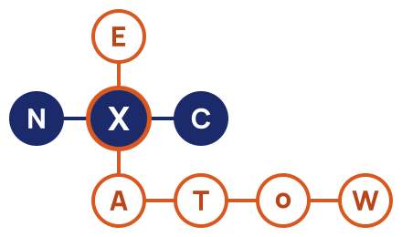

# Exa-AtoW with nxc

<p align="center">
  
</p>
Proof of concept and canonical example for deploying Exa-AtoW style HPC
infrastructure using NixOS-Compose.

The shipped composition, `openqcd`, brings up ebuffer, ebservice, a SLURM
frontend and controller, and two compute nodes running a small OpenQCD 2.0 HMC
workload. This is a local development demonstrator, not a production service.


**Documentation:** <https://unk1ndled.github.io/nxc-Exa-AtoW/>
(source in [`docs/src/`](docs/src/README.md))

## Quick start

```console
just nxc-test   # build openqcd and run its test inside NXC
just up         # start the topology in the foreground (Ctrl-C to stop)
```

See the [command reference](docs/src/reference/commands.md) for every recipe,
the [tutorial](docs/src/tutorial/quickstart.md) to add your own application,
and the [development notes](docs/src/DevNotes.md) for local testing shortcuts.

## Layout

| Path | Contents |
| --- | --- |
| `cluster/` | Shared topology: ebuffer, ebservice, SLURM, shared storage, readiness checks. |
| `pkgs/<name>/` | One package per directory, with its NixOS module and NXC test when deployable. |
| `compositions.nix` | Every composition: compute groups, enabled packages, test script. |
| `clients/` | Optional infrastructure clients: the Python E2E and the web notebook client. Not needed to build or test. |
| `docs/` | The mdBook (`just docs`, `just docs-serve`). |
