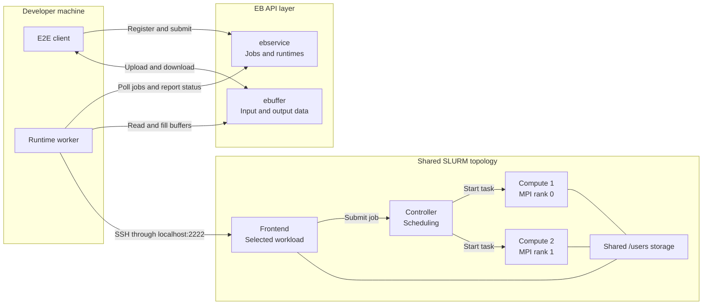

# canonical Exa-AtoW with nxc
Proof of concept and canonical example for deploying Exa-AtoW style HPC infrastructure using NixOS-Compose.

## Architecture



This repository ships one NixOS-Compose composition, `openqcd`: ebuffer,
ebservice, a SLURM frontend and controller, and the two compute nodes that run
a small, real OpenQCD 2.0 HMC workload (`ym1`).

Compute nodes are declared as groups of identical nodes with a `count`, and
each group enables the apps its nodes run, so another cluster shape is one more
entry in `compositions.nix`. Compute nodes advertise their apps as SLURM
features. The `mpi-hello` app is available to enable in such a composition.

To integrate another application, follow the step-by-step
[mdBook tutorial](docs/src/tutorial/quickstart.md).


## Repository layers

| Layer | Location | Responsibility |
| --- | --- | --- |
| Shared infrastructure | `cluster/topology.nix` | Builds the ebuffer, ebservice, shared-storage, Munge, and SLURM topology, and waits for it to be ready before each test. |
| Apps | `apps/<name>/` | One NixOS module with an `exa-atow.apps.<name>.enable` option, its sources, a SLURM job, and an NXC test script per app. |
| Compositions | `compositions.nix` | Every composition: compute groups and their counts, the apps each enables, and which tests run. |
| Optional API client | `clients/python-e2e/` | Python client that drives a job through ebservice and ebuffer. Not needed to build, deploy, or run the NXC tests. |

To add an application, create `apps/<name>/` following the
[tutorial](docs/src/tutorial/quickstart.md).

## End-to-end behavior

The default `just test` path:

1. authenticates with ebservice;
2. registers the OpenQCD microservice and compatible runtime;
3. uploads `apps/openqcd/openqcd-ym1.in` and creates scheduler and output ebuffers;
4. submits a two-node SLURM job through the frontend;
5. runs one `ym1` rank on each compute VM;
6. returns `openqcd-e2e.log` through ebuffer;
7. validates the lattice and process grid, one trajectory, configuration
   export, and a finite plaquette on the client.

These tests cover the current local package, API, shared-storage, SLURM, MPI,
and output-transfer paths. They do not establish production security,
persistent storage, normal remote SCP, full scheduler accounting, large
transfers, non-VM E2E behavior, portable CPU emulation, failure recovery, or
concurrent multi-user behavior.

See the [development notes](docs/src/DevNotes.md) for the local compatibility
adapters and testing shortcuts.


## Commands

The default flavour is `vm` and the default composition is `openqcd`. For
`build`, `up`, and `down`, the flavour is the first optional argument and the
composition second:

```console
just up                            # openqcd::vm
just up vm my-cluster              # my-cluster::vm, once declared

just down docker                   # stop openqcd::docker
```

The two test layers select only a composition because they exercise the VM
flavour:

```console
just nxc-test                      # OpenQCD in-topology integration test
just tunnel                        # expose the running OpenQCD VM
just test                          # OpenQCD API-to-SLURM host E2E
just test my-cluster mpi-hello     # one app's host E2E on another composition
```

`just nxc-test` builds the selected composition and runs its test from inside
NXC. `just test` expects that composition's VM deployment to be running,
establishes its tunnels, and launches the selected application's host E2E. Its
second argument defaults to the composition name for single-application
compositions. Use `just install` once to create `clients/python-e2e/.venv` from the locked
dependencies.

Stop a VM deployment by interrupting its foreground `just up` process with
Ctrl-C. NXC's VM flavour has no standalone cleanup, so `just down` does not stop
VMs; it remains available for flavours that implement cleanup.


## Documentation

The repository includes a full mdBook with separate concepts, architecture,
tutorial, and reference sections:

```console
just docs
just docs-serve
```

The generated site is written to `docs/book/`; the live server defaults to
`http://127.0.0.1:3000`. Start at the
[book introduction](docs/src/README.md) or browse its
[table of contents](docs/src/SUMMARY.md).

Commits to the default branch publish the book on
[GitHub Pages](https://unk1ndled.github.io/nxc-Exa-AtoW/).
